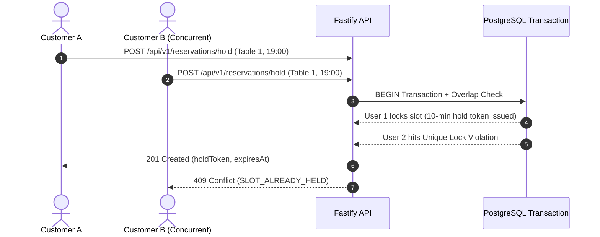
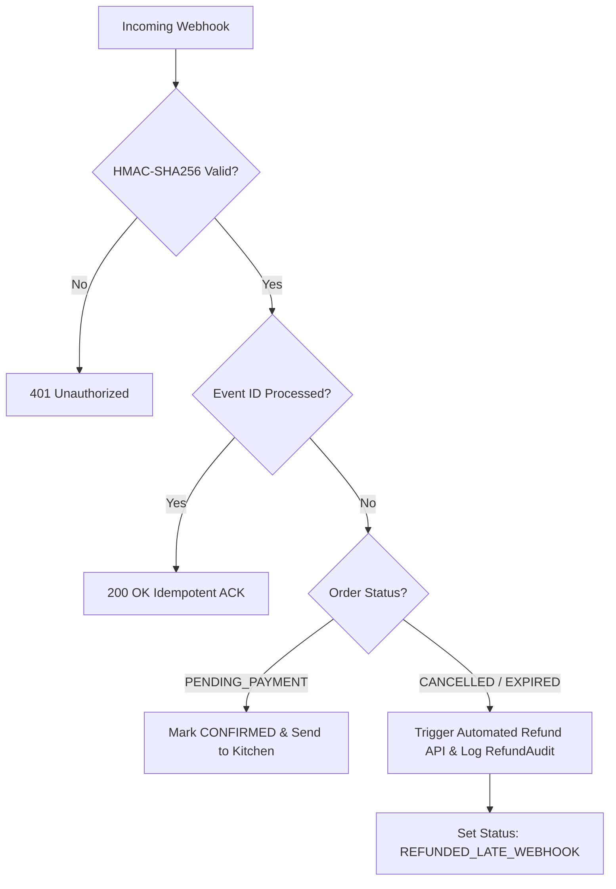

# ☕ Artisan Cafe Backend Engine (Node.js + Fastify + TypeScript)

[](https://github.com/ihardik-dev/Cafe/actions)


-orange)

A production-grade, enterprise backend for a specialty coffee shop and artisanal bakery. Designed with strict **concurrency controls**, **zero double-booking table reservations**, **server-side cart calculations with 5% GST**, and a **fault-tolerant payment webhook engine with automated refunds for delayed payments**.

---

## 🌟 Key Engineering Highlights

### 1. Zero Double-Booking Reservation Engine
* **The Race Condition Challenge**: Multiple users attempting to book the same table slot at the exact same millisecond.
* **The Solution**: 
  * 10-minute temporary reservation holds (`ReservationHold`) backed by a PostgreSQL compound unique constraint: `@@unique([tableId, slotStartTime])`.
  * Multi-interval overlap conflict detection: `existing.startTime < slotEnd AND existing.endTime > slotStart`.
  * **Verified**: 20 parallel concurrent requests competing for 1 slot result in exactly 1 acquisition and 19 clean conflict rejections (`409 Conflict`).



---

### 2. The Late-Webhook Automated Refund Engine
* **The Problem**: A customer begins checkout with a 15-minute payment window. The gateway or bank webhook is delayed by 45 minutes. Meanwhile, the background cleanup worker cancels the order and releases the reserved croissant stock to another customer.
* **The Solution**: When the late `payment.captured` webhook arrives, the engine verifies the HMAC signature, checks the status, refuses to fulfill the stale order, and **automatically initiates an instant refund API call**, sets the status to `REFUNDED_LATE_WEBHOOK`, and records an immutable audit log in `RefundAudit`.



---

### 3. Real-Time Atomic Inventory Concurrency
* Perishable baked goods (e.g., Almond Croissants) have strict daily baked limits.
* Atomic stock decrements execute inside ACID transactions with rollback guards, guaranteeing inventory cannot be overdrawn into negative numbers under extreme traffic.

---

## 🛠️ Tech Stack

| Layer | Technology | Purpose |
| :--- | :--- | :--- |
| **Runtime** | Node.js (v20+) | High throughput asynchronous event loop |
| **Language** | TypeScript (Strict mode) | Type safety, zero untyped `any`, strict compiler flags |
| **Web Framework**| Fastify | High-performance routing, built-in schema validation |
| **Database** | PostgreSQL 16 | ACID transactions, compound unique constraints, relational data |
| **ORM** | Prisma ORM 6.x | Type-safe migrations, queries, and seeding |
| **Security** | `@fastify/jwt` + `bcryptjs` + SHA-256 | Bcrypt with SHA-256 pre-hashing (eliminates 72-byte truncation) |
| **Background Jobs**| BullMQ + Redis 7 | Expiration sweeps, unconfirmed hold reclamation |
| **Testing** | Vitest | 59 adversarial edge-case break tests (concurrency, tampering, replays) |
| **Documentation** | Swagger / OpenAPI 3.0 | Interactive live documentation at `/docs` |

---

## 🚀 Quickstart Guide

### Option A: Run Infrastructure with Docker Compose
```bash
# 1. Start PostgreSQL & Redis
docker compose -f backend/docker-compose.yml up -d

# 2. Enter backend directory & install dependencies
cd backend
npm install

# 3. Generate Prisma client & apply migrations
npx prisma db push

# 4. Seed authentic cafe items, categories, and tables
npm run prisma:seed

# 5. Start dev server
npm run dev
```

### Option B: Local Development
Ensure PostgreSQL is running locally on port `5432` with a database named `cafe_db`, then:
```bash
cd backend
npm install
npx prisma generate
npx prisma db push
npm run prisma:seed
npm run dev
```

The server boots up at:
* **API Base URL**: `http://localhost:4000`
* **Interactive Swagger UI**: `http://localhost:4000/docs`

---

## 🧪 Automated Adversarial Test Suite

Every module is hardened against malicious tampering and race conditions using Vitest:

```bash
cd backend
npm test
```

```text
 ✓ tests/step1_schema_break.test.ts (21 tests)
 ✓ tests/step2_auth_break.test.ts (10 tests)
 ✓ tests/step3_menu_inventory_break.test.ts (10 tests)
 ✓ tests/step4_order_state_break.test.ts (7 tests)
 ✓ tests/step5_reservation_break.test.ts (6 tests)
 ✓ tests/step6_payments_webhooks_break.test.ts (5 tests)

Test Files  6 passed (6)
Tests       59 passed (59)
Duration    ~2.1 seconds
```

### Key Vulnerabilities Tested & Blocked:
1. **Bcrypt 72-Byte Truncation Vulnerability**: Pre-hashed refresh tokens with SHA-256 to prevent false collisions on long JWTs.
2. **Sub-second Token Rotation Collision**: Nonces (`jti: crypto.randomUUID()`) added to refresh tokens for guaranteed rotation uniqueness.
3. **Privilege Escalation**: Injected `role: "ADMIN"` parameters are stripped from signup payloads.
4. **Price Spoofing**: Injected `totalInPaise: 0` is ignored; server calculates base price + modifiers + 5% GST.
5. **Double Reservation Race Conditions**: 20 simultaneous parallel requests result in exactly 1 hold and 19 clean 409 rejections.
6. **Double Webhook Delivery**: Webhook idempotency table deduplicates concurrent gateway retries.

---

## 🤝 Frontend Developer Handoff

For the frontend team or collaborators:

### 1. Currency Standard (Indian Rupees / Paise)
All prices in the database and API responses are integers in **paise** ($₹1.00 = 100 \text{ paise}$) to avoid floating-point errors (`0.1 + 0.2 != 0.3`).

Format prices in the UI using this helper:
```typescript
export function formatRupees(amountInPaise: number): string {
  return `₹${(amountInPaise / 100).toFixed(2)}`;
}
// formatRupees(24000) -> "₹240.00"
// formatRupees(16000) -> "₹160.00"
```

### 2. Postman Collection
Import the pre-configured collection file located at:
📁 `backend/cafe-api.postman_collection.json`

Features:
* Automatic JWT token capture in collection variables.
* Pre-configured requests for Auth, Menu, Orders, Table Reservations, and Payments.

### 3. Core API Endpoints

| Method | Endpoint | Description | Auth Required |
| :--- | :--- | :--- | :--- |
| `POST` | `/api/v1/auth/register` | Register new customer account | Public |
| `POST` | `/api/v1/auth/login` | Login and receive Access + Refresh tokens | Public |
| `POST` | `/api/v1/auth/refresh` | Rotate and refresh access token | Public |
| `GET` | `/api/v1/auth/me` | Current user profile | Bearer Token |
| `GET` | `/api/v1/menu` | Full nested menu with modifier groups | Public |
| `GET` | `/api/v1/menu/items/:id` | Item details with available modifiers | Public |
| `POST` | `/api/v1/orders/checkout` | Cart checkout with atomic inventory hold | Optional Auth |
| `GET` | `/api/v1/orders/:orderId` | Order details and status history | Optional Auth |
| `GET` | `/api/v1/orders/my-orders` | Customer order history | Bearer Token |
| `GET` | `/api/v1/reservations/tables` | List tables with capacities & dining areas | Public |
| `GET` | `/api/v1/reservations/available-slots` | Check available slots by date & guests | Public |
| `POST` | `/api/v1/reservations/hold` | 10-minute temporary table slot hold | Optional Auth |
| `POST` | `/api/v1/reservations/confirm` | Finalize table booking with holdToken | Optional Auth |
| `POST` | `/api/v1/payments/create-intent` | Initiate payment for order | Optional Auth |
| `POST` | `/api/v1/payments/webhook` | Gateway HMAC webhook listener | Gateway Signature |

---

## 📜 License
MIT License. Built for freelance production showcase.
